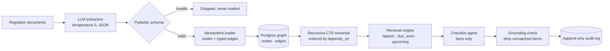

# License Compliance Graph Engine

**Models U.S. multi-state licensing rules as a graph in plain Postgres, extracts requirements from regulator documents with a schema-validated LLM pass, computes exactly what a company owes and when, and drafts a filing checklist that can't include a rule the graph doesn't contain.**

A payments company operating in a dozen states must hold the right license in each one, meet each state's ongoing requirements, and renew on each state's schedule — and the source of truth is a pile of regulator PDFs. "What does Acme owe by March?" is a graph question: entity → states → licenses held → requirements → due dates. This FastAPI service answers it, and keeps an audit record of every answer.



## The graph

| Nodes | Edges |
|---|---|
| `state`, `license_type`, `requirement`, `entity` | `offers` (state → license type), `requires` (license type → requirement), `renews_every` (requirement self-edge with interval), `depends_on` (requirement → prerequisite), `holds` (entity → license type), `operates_in` (entity → state) |

Nodes are unique on `(type, key)` and edges on `(src, dst, type)`, so reloading the same extraction is a no-op. [ARCHITECTURE.md](ARCHITECTURE.md) explains why this lives in Postgres adjacency lists rather than a dedicated graph database.

## Why the answers are trustworthy

- **Validated extraction.** The LLM must return records matching a strict Pydantic schema — two-letter state code, a closed set of cadences (`one_time`, `annual`, `biennial`, `quarterly`, `monthly`), interval, dependency, source page. Anything that doesn't validate is discarded, never loaded.
- **Deterministic obligations.** One SQL query walks entity → states → offered licenses the entity actually holds → required obligations, and orders requirements so prerequisites come first.
- **Pure date math.** Next due date = last filing + interval (via `relativedelta`). Items are classified `lapsed`, `due_soon` (within 45 days), `upcoming`, or `unknown`, most urgent first.
- **The agent only sees computed facts.** The checklist model receives the graph's obligations and due dates, nothing else, at temperature 0.
- **Post-generation grounding.** Every checklist item must match a fact on (requirement, state, due date); unmatched items are moved to `dropped_ungrounded`, and the response reports a `grounded_ratio`.
- **Defensible after the fact.** Each answer is written to an append-only `audit_log` with the inputs, the facts used, the response, and the grounding ratio.

## Example

Three extracted California and Texas requirements, where the CA annual report depends on the surety bond, for an entity that holds a money transmitter license in both states. Evaluated on 2026-10-12, with the bond last filed 2025-09-01 and the report 2025-11-20:

```text
traversal (state, requirement, dependency depth)
  TX  Renewal Fee     0
  CA  Surety Bond     0
  CA  Annual Report   1

renewal engine
  lapsed    CA  Surety Bond    due 2026-09-01   -41 days
  due_soon  CA  Annual Report  due 2026-11-20    39 days
  upcoming  TX  Renewal Fee    due 2027-10-12   365 days
```

This output was produced against PostgreSQL 16 after applying the one-word fix described under *Status*.

## Quick start

Requires Python 3.10+, PostgreSQL, and an OpenAI API key for extraction and checklist drafting.

```bash
git clone https://github.com/AliAzamat/license-compliance-graph-engine.git
cd license-compliance-graph-engine
pip install fastapi uvicorn "psycopg[binary]" psycopg_pool pydantic python-dateutil openai

createdb compliance
export DATABASE_URL=postgresql:///compliance
export OPENAI_API_KEY=<your key>

uvicorn app.main:app --reload    # applies the schema on startup
```

```bash
curl -X POST localhost:8000/compliance/checklist \
  -H "Content-Type: application/json" \
  -d '{"entity_key": "acme", "last_filed": {"<requirement-id>": "2025-09-01"}}'
```

## Layout

| Path | Purpose |
|---|---|
| `app/extraction/` | Extraction prompt, Pydantic schema, validated LLM call |
| `app/graph/` | Graph repository (idempotent upserts), loader, traversal query |
| `app/renewals/engine.py` | Due-date computation and urgency classification |
| `app/agent/` | Fact gathering, checklist prompt, JSON completion, grounding check |
| `app/api/routes/compliance.py` | `POST /compliance/checklist` |
| `app/repositories/audit.py` | Append-only audit writes |
| `app/models/schema.sql` | `nodes`, `edges`, `audit_log` |

## Status

- **Bug: the traversal query needs `WITH RECURSIVE`.** It defines a recursive CTE with a plain `WITH`, so Postgres rejects it. Changing `WITH ent AS` to `WITH RECURSIVE ent AS` in `app/graph/traversal.py` fixes it; that's the only change needed for the example above.
- **No ingestion path for entities.** The loader creates states, license types, and requirements, but nothing creates `entity` nodes or `holds`/`operates_in` edges yet — they have to be inserted directly.
- **No document-ingestion endpoint;** `extract()` is called from code, and PDF-to-text conversion isn't included.
- A recurring requirement that has never been filed is scheduled one interval from today and marked `upcoming`, rather than flagged as missing.
- No dependency file or tests.
